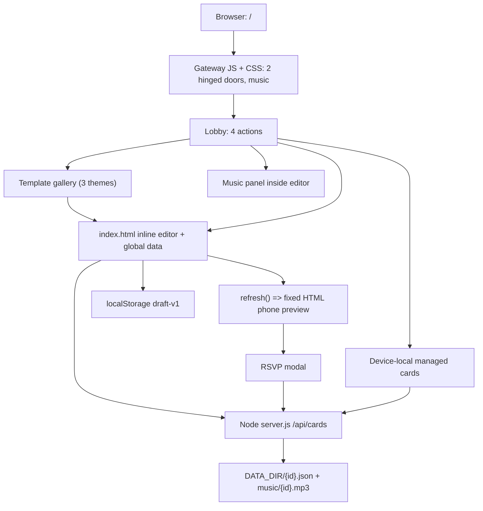

# Hỷ Studio — Code Map & Refactor Plan
**Ngày rà soát:** 22/10/2026  
**Nguồn:** `minhduchd-mds/Thi-p-m-i`, nhánh `main`, baseline `0a3f0642d62392dbe697748d722195316cd38c3b` (v1.7.0).  
**Loại tài liệu:** Audit cấu trúc + đề xuất, **chưa phải báo cáo đã triển khai editor kéo thả**.

## 0. Phạm vi / phương pháp / giới hạn
- Đọc Git tree đầy đủ (không bị truncate), nội dung `index.html`, `hy-gateway.js`, `hy-gateway.css`, `server.js`, `package.json`, test và CI.
- Phân tích theo luồng tương tác, DOM ID, hàm JS, CSS, payload và đường API; đối chiếu yêu cầu editor kéo thả theo ảnh tham khảo người dùng gửi.
- Baseline có CI thành công: [GitHub Actions run 39562297577](https://github.com/minhduchd-mds/Thi-p-m-i/actions/runs/39562297577). Đây là bằng chứng chạy test hiện có, **không** phải chứng nhận visual/E2E editor mới.
- Chưa thực hiện kiểm chứng pixel/screenshot trên Chrome/Safari/iPhone trong đợt rà soát; kết luận UI đến từ mã. Chưa sửa hoặc xoá file runtime trong bước lập bản đồ.

## 1. Bản đồ thư mục thực tế (AS-IS)
```text
Thi-p-m-i/
├── public/                              [Web static root / Vercel preview]
│   ├── index.html                      [~65.7 KB, toàn bộ Editor + preview + inline CSS + inline JS]
│   ├── hy-gateway.js                   [~11.2 KB, cổng + nhạc + điều hướng sảnh]
│   ├── hy-gateway.css                  [~30.2 KB, CSS 3D + trang trí + nhiều lớp ghi đè]
│   ├── hy-courtyard.svg                [~30.8 KB, cảnh sân sau cửa]
│   └── assets/
│       ├── music/
│       │   ├── loi-hen-tram-nam.mp3
│       │   ├── duyen-ngoc-phuong-dong.mp3
│       │   ├── ngay-vui-chung-doi.mp3
│       │   ├── binh-minh-hanh-phuc.mp3
│       │   ├── lua-hong.wav
│       │   ├── song-hy.wav
│       │   └── trang-vien.wav
│       ├── ornaments/
│       │   ├── carved-door.svg
│       │   ├── song-hy.svg
│       │   ├── gold-corner.svg
│       │   └── plum-branch.svg
│       └── textures/
│           └── wood-mahogany.webp
├── server.js                            [~11.7 KB, HTTP server + cards + RSVP + nhạc + TTL]
├── test-api.js                          [API integration]
├── test-gateway.js                      [Static UI/assets contracts]
├── test-gateway-interaction.js          [Mô phỏng DOM cho cổng]
├── generate_music.py                    [Công cụ tạo nhạc offline; không phải runtime]
├── bo-mau-thiep-cuoi.png                [Ảnh ở root; cần xác nhận còn nơi dùng]
├── package.json                         [Node >=22; không có framework, bundler hay deps ngoài]
├── .github/workflows/ci.yml            [Node check, asset validation, API integration]
├── .gitignore
└── README.md
```

## 2. Phân rã chức năng hiện tại (AS-IS)

| Khối | Entry / DOM | State / logic | Trạng thái thực tế |
|---|---|---|---|
| Cổng hai cánh | `#hy-gateway`, `.hy-door--left/right`, `#hy-enter` | `hy-gateway.js`: `openDoors`, `finishOpening`; CSS `rotateY` | Có CSS 3D bản lề; **không phải mesh/WebGL hay camera 3D** |
| Nhạc sảnh | Tạo `audio#hy-gateway-music` & `#hy-sound-toggle` bằng JS | `startWelcomeMusic`, `stopWelcomeMusic` | Nhạc phát sau thao tác mở cửa; fade-out khi vào editor |
| Sảnh 4 chức năng | `#hy-page-hall`, `[data-hy-action]` | `setPage`, `gotoEditor`, `showManager` | Thư viện / thiết kế / nhạc / quản lý |
| Thư viện mẫu | `#hy-page-library`; 3 card | click `button.template[data-theme]` | Có đúng **3 theme**; chưa có layout-schema riêng |
| Editor đang dùng | `#chinh-sua`, `#panel-content`, `#panel-style`, `#panel-music` | Inline JS trong `index.html` | **Form editing**, không có draggable/resizable/selectable blocks |
| Bản xem trước | `#phone-screen`, `#invite-root`, `#cover`, `#envelope` | `refresh()` cập nhật text/ảnh/ CSS class | Cover + love story + save-the-date + RSVP là HTML bố cục cố định |
| Theme | `[data-theme=red/jade/pink]`, `theme-red/jade/pink` | `data.theme`, `refresh()` | Thay màu/biến CSS và font; **không tự sắp xếp lại thành phần theo theme** |
| Text | `#font-style` | `data.font`, `font-script/serif/modern` | 3 font mode; không chỉnh thuộc tính theo block |
| Ảnh cưới | `#photo`, `#out-photo` | `compressImage()` canvas -> JPEG data URL | Một trường ảnh; không có asset manager / crop/position cho nhiều layer |
| Nhạc thiệp | `#panel-music`, `audio#bg-music` | `setMusic()`, `toggleMusic()`, upload MP3 | Có nhạc preset, upload, volume/start/seek |
| Lưu bản nháp | Không có workspace selector | `localStorage` key `hy-studio-draft-v1` | Một bản nháp theo trình duyệt; TTL phía client |
| Tạo/chỉnh thiệp | `#save-card`, `#copy-link` | `saveCard()`, `loadCardFromUrl()` | API Node + edit token localStorage; không có tài khoản/đồng bộ |
| RSVP & lời chúc | `#rsvp-form`, `#replies-modal` | `sendRSVP()`, `showResponses()` | Hoạt động khi có Node backend; không hoạt động trên preview tĩnh thuần |

### Sơ đồ hiện trạng


## 3. Editor data map (AS-IS)
Client model `defaults` trong inline script:
```text
bride, groom, date, time, venue, address, guest, message
theme: red | jade | pink
font: script | serif | modern
music, musicStart, volume
photo: JPEG data URL (optional)
```
- Các hàm chính: `refresh`, `update`, `saveDraft`, `loadDraft`, `compressImage`, `setMusic`, `openEnvelope`, `openModal`, `saveCard`, `loadCardFromUrl`, `sendRSVP`, `showResponses`.
- `refresh()` cập nhật nội dung của **DOM ID cố định**; không có `blocks[]`, `selectedBlockId`, `layers[]`, `transform`, `undoStack` hay `layoutId`.
- Đang hiển thị preview trong khung điện thoại; editor `.workspace` chia 3 cột: form | phone preview | thông tin bổ sung, **không phải** thư viện kéo thả | canvas | thuộc tính.
- Có tổng cộng **93 DOM ID** trong `index.html`; không phát hiện ID trùng theo cách đếm văn bản HTML.

## 4. API / lưu trữ / giới hạn tương thích

| HTTP | Đường dẫn | Vai trò |
|---|---|---|
| GET | `/api/health` | Sức khỏe server và TTL |
| POST | `/api/cards` | Tạo thiệp + cấp `editToken` |
| GET | `/api/cards/:id` | Xem dữ liệu công khai |
| PUT | `/api/cards/:id` | Sửa thiệp có Bearer editToken |
| PUT | `/api/cards/:id/music` | Upload MP3 riêng, có quyền |
| GET | `/api/cards/:id/music` | Phát nhạc có HTTP Range |
| POST | `/api/cards/:id/rsvp` | Nhận RSVP/lời chúc |
| GET | `/api/cards/:id/rsvps` | Chủ thiệp xem phản hồi |

- Backend chỉ nhận dữ liệu qua `sanitizeData(raw)` với các field v1 nói trên. Nếu frontend mới gửi `blocks[]` thì **server sẽ bỏ mất các block** (P0 trước khi công bố editor v2).
- `LIMIT_BYTES = 1_700_000` và ảnh JPEG data URL tối đa `1_200_000` ký tự; không phù hợp nhúng nhiều WebP/ảnh vào một thiệp.
- `MUSIC_LIMIT_BYTES = 8 MiB`; dữ liệu file: `DATA_DIR/{id}.json`, `DATA_DIR/music/{id}.mp3`, TTL 30 ngày cố định từ lúc tạo.
- Quyền chỉnh sửa giữ tại trình duyệt (`hy-studio-owner-{uuid}` trong localStorage); **không có account/RLS/asset storage**.
- Phục vụ file trong `serveStatic()` hiện chỉ cho `.html/.js/.css/.svg/.mp3/.wav`: **thiếu `.webp` và `.png`**. Khi chạy Node server trực tiếp, request texture gỗ WebP trả 404. Vercel static là cơ chế khác nên không thể lấy preview tĩnh làm bằng chứng Node server hỗ trợ WebP.
- Deployment preview static root `public/` không chạy `server.js`: tính năng POST/PUT API / RSVP cần backend thật.
- Việc đọc `data.photo` và cập nhật nguyên trạng edit token cần preserve bảo mật; không đưa token vào link guest.

## 5. Vấn đề kỹ thuật theo mức ưu tiên

| Ưu tiên | Vấn đề có bằng chứng trong code | Ảnh hưởng | Hướng xử lý |
|---|---|---|---|
| **P0** | Không có block schema, parser/renderer và drag engine | Không thể kéo thả thực | Thiết kế `InvitationDocumentV2` rồi build canvas layer |
| **P0** | Server `sanitizeData` chỉ giữ field v1 | Editor v2 lưu sẽ mất layer | API versioning + migration v1 -> v2 + regression test |
| **P0** | Node `serveStatic` thiếu WebP/PNG | Texture hoặc WebP mới 404 trên server thật | MIME + cache + response tests |
| **P0** | Vercel static không có backend | Save/publish/RSVP không hoạt động end-to-end | Deploy API persistent riêng / reverse proxy, không thông báo hoàn thành production sớm |
| **P1** | `index.html` chứa HTML + ~20 KB CSS inline + ~19 KB inline JS | Khó bảo trì, dễ lỗi khi nối thêm chức năng | Tách editor theo module, không rewrite cả lần |
| **P1** | Theme chỉ đổi class màu và font | Ba theme chưa có layout độc lập | Mỗi theme là token + preset layout + layer manifest |
| **P1** | Ảnh một JPEG data URL, không có asset ID | Kéo ảnh nhiều lớp sẽ bùng dung lượng | Asset manifest và storage WebP/object storage |
| **P1** | Test UI dựa vào regex/DOM mock, chưa có visual E2E | CI xanh chưa đảm bảo UX đúng | Playwright: screenshots desktop/mobile, drag/resize/theme/export |
| **P1** | Dữ liệu thiệp một bản nháp/local edit token | Thiếu quản lý đa thiệp, đa máy | V1 giữ nguyên; bổ sung account + ownership ở giai đoạn backend |
| **P2** | CSS cổng + inline style đã có nhiều lần ghi đè | Khó xác định style nguồn / specificity | Chuẩn hoá tokens, gom các rule trùng sau khi có visual snapshots |
| **P2** | `bo-mau-thiep-cuoi.png` tại root, không thấy nơi import trong runtime | Có thể là ảnh tham chiếu | Kiểm chứng usages/docs trước khi chuyển thành design reference |
| **P2** | `generate_music.py` là công cụ offline | Không nên nạp vào web bundle | Chuyển sang `tools/` hoặc giữ root có chú thích; **không xoá nhạc tương thích** |

> Đây là ưu tiên từ đọc mã, chưa phải các lỗi đã được tái hiện bằng ảnh chụp browser.

## 6. TO-BE: kiến trúc editor kéo thả không phá luồng cũ
**Khuyến nghị:** giữ vanilla ES modules + CSS trong `public/` giai đoạn đầu (hiện dự án không có bundler). Không thêm React/Next chỉ để đạt editor drag-drop. Sau khi block schema ổn định mới cân nhắc framework/migration.

```text
public/
├── index.html                        [giữ entry; rút inline editor code sau khi ổn định]
├── hy-gateway.js                     [giữ tương thích link guest và nhạc]
├── hy-gateway.css
├── editor/
│   ├── main.js                      [bootstrap/editor shell]
│   ├── core/
│   │   ├── document-schema.js       [v1 -> v2, migrations, validation]
│   │   ├── editor-store.js          [single source of truth]
│   │   ├── commands.js              [undo/redo, duplicate, delete, lock]
│   │   ├── selection.js             [selectedBlockId, multi-select]
│   │   └── geometry.js              [snap, bounds, transforms, z-order]
│   ├── blocks/
│   │   ├── registry.js              [text/image/ornament/frame/date/QR...]
│   │   ├── block-renderer.js
│   │   └── block-presets.js
│   ├── ui/
│   │   ├── editor-shell.js
│   │   ├── toolbar.js
│   │   ├── left-library.js
│   │   ├── canvas-stage.js
│   │   ├── right-inspector.js
│   │   └── layers-panel.js
│   ├── themes/
│   │   ├── hong-hy.js
│   │   ├── ngoc-uyen.js
│   │   ├── hoa-van.js
│   │   └── theme-engine.js
│   ├── services/
│   │   ├── asset-catalog.js
│   │   ├── draft-storage.js
│   │   ├── card-api.js
│   │   └── export-image.js
│   └── styles/
│       ├── tokens.css
│       ├── shell.css
│       ├── canvas.css
│       └── inspector.css
└── assets/
    ├── ornaments/                    [SVG cho linework/logo]
    ├── textures/                     [WebP cho gỗ/giấy/nền]
    ├── invitation-themes/
    │   ├── hong-hy/
    │   ├── ngoc-uyen/
    │   └── hoa-van/
    └── fonts/                        [chỉ thêm font có giấy phép, không commit font chưa có quyền]
```

### Document v2 (đề xuất, chưa có trong repo)
```json
{
  "schemaVersion": 2,
  "themeId": "hong-hy",
  "layoutId": "traditional-centered",
  "canvas": {"width": 1080, "height": 1920, "backgroundAssetId": "red-silk"},
  "fields": {
    "bride": "Minh Anh",
    "groom": "Hoàng Nam",
    "date": "2027-06-20",
    "time": "17:30",
    "venue": "The Garden Wedding Hall"
  },
  "blocks": [
    {
      "id": "blk-title",
      "type": "text",
      "content": {"binding": "bride"},
      "transform": {"x": 200, "y": 280, "w": 680, "h": 120, "rotation": 0},
      "style": {"fontToken": "display", "colorToken": "ink"},
      "zIndex": 10,
      "locked": false,
      "hidden": false
    }
  ],
  "assetRefs": [],
  "meta": {"migratedFrom": 1}
}
```

**Quy tắc dữ liệu:** `fields` là nguồn chuẩn thông tin nghiệp vụ, `blocks` quyết định cách hiển thị. Khi đổi theme, **tạo layout preset mới có kiểm soát** hoặc chỉ remap token theo chế độ người dùng chọn; không tự xoá text/ảnh custom. Phải có undo và cảnh báo nếu reflow sẽ thay đổi thủ công.

### Editor mới (desktop 1366×768 trước)
```text
┌────────────────────────────────────────────────────────────────────────────┐
│ Logo   Thiệp của tôi  ·  Theme  ·  Undo Redo  ·  Preview  ·  Lưu / Xuất   │
├───────────────┬───────────────────────────────────────┬────────────────────┤
│ THƯ VIỆN     │              CANVAS                   │ THUỘC TÍNH         │
│ Mẫu/layout   │  Zoom / ruler / grid / snap          │ Vị trí, kích cỡ    │
│ Text          │  Kéo thả các block trên thiệp         │ Font, màu, layer   │
│ Hoạ tiết      │  Selection bbox + resize handles      │ Asset/crop/opacity │
│ Ảnh/WebP      │  Responsive preview                  │ Khoá/ẩn/nhân bản  │
│ QR, RSVP      │                                       │                    │
│ Layers        │                                       │                    │
└───────────────┴───────────────────────────────────────┴────────────────────┘
```
- Pointer events + pointer capture, drag preview, grid snapping, keyboard nudge, z-index/layers, constrain within canvas; drop từ thư viện bằng `DragEvent` + hỗ trợ click-to-add / keyboard.
- Phải phân biệt `design canvas` với `guest runtime viewer`: người nhận thiệp không tải editor JS, không có edit token.
- Canvas responsive theo tọa độ thiết kế chuẩn; zoom là transform trên viewport, **không chỉnh trực tiếp dữ liệu vị trí khi phóng to**.
- QR/RSVP là block tương tác được kiểm soát qua registry, không cho chèn script HTML tùy ý.
- Preview sẽ dùng chính block renderer của runtime; export có kiểm thử font/ảnh CORS và chất lượng 2×/3×.

## 7. 3 theme: đổi layout THẬT, không chỉ màu

| Theme | Màu/token | Cấu trúc bố cục | WebP material | SVG |
|---|---|---|---|---|
| **Hồng Hỷ** | đỏ son, đỏ mận, vàng kim | Cân trục giữa, huy hiệu ở đỉnh, viền dày, cụm tên cân đối | Gỗ sơn đỏ, gấm, giấy đỏ | Song Hỷ, khung vàng, hoa mai |
| **Ngọc Uyển** | xanh ngọc, trắng kem, champagne | Nhiều khoảng trắng, bảng tên dọc mảnh, ảnh chính lệch theo grid | Giấy mỹ thuật, đá ngọc, lụa xanh | Mây, đường viền mảnh, nhánh lá |
| **Hoa Vân** | hồng phấn, beige, vàng nhạt | Bất đối xứng có chủ đích, nhóm hoa xen chữ, dải hình ảnh | Giấy vân, cánh hoa, nền lụa | Hoa đào, mây, ornament góc |

Với mỗi theme phải có ít nhất **một layout preset khác cấu trúc thực**, một thumbnail được tạo từ chính renderer, một bộ token và asset manifest. Text hiển thị tiếng Việt phải có fallback; font trang trí cho title, body ưu tiên đọc rõ. Kiểm tra giấy phép trước khi đưa font về `assets/fonts/`.

## 8. Refactor theo cụm lớn (thứ tự thực thi)

| Cụm | Phạm vi / file | Điều kiện nghiệm thu |
|---|---|---|
| **C0 — Baseline & blockers** | Tests, `server.js`, xác minh asset WebP/MIME và API preview | Snapshot cổng/editor/thiệp, phân định static và API; server phục vụ WebP; test API đỏ/xanh có thể truy vết |
| **C1 — Editor shell** | `public/editor/main.js`, `ui/*`, `styles/*`, entry `index.html` | Desktop 1366×768: toolbar + library + canvas + inspector; không tràn, không mất luồng guest |
| **C2 — Block & drag engine** | `core/*`, `blocks/*`, `canvas-stage.js`, `layers-panel.js` | Kéo, resize, rotate, chọn, snap, align, reorder, undo/redo, khoá/ẩn/nhân bản hoạt động thật; UI test |
| **C3 — Three layout/theme engine** | `themes/*`, `block-presets.js`, `document-schema.js` | Hồng Hỷ, Ngọc Uyển, Hoa Vân khác bố cục lẫn màu; dữ liệu nghiệp vụ giữ nguyên khi đổi |
| **C4 — Assets/WebP/font** | `services/asset-catalog.js`, `assets/invitation-themes/`, inspector | Kéo WebP/SVG vào canvas, load ảnh đúng, quản lý asset/fit/crop; không bể ảnh, không vi phạm giấy phép |
| **C5 — Save/export/runtime** | `server.js`, `card-api.js`, `draft-storage.js`, `export-image.js`, viewer | Round-trip v2 qua API không mất blocks; load v1 được; xuất PNG/WebP thật; guest RSVP/music vẫn chạy |

**Nguyên tắc triển khai:** hoàn thành/kiểm chứng cụm rồi mới gỡ đường code cũ. Không gộp refactor editor với sửa logic expiry/token/RSVP trong một thay đổi không kiểm soát. Push `main` chỉ sau test pass; báo rõ phần nào chưa kiểm chứng browser.

## 9. KEEP / MOVE / REPLACE / CANDIDATE TO REMOVE

| Quyết định | Mục | Lý do |
|---|---|---|
| **KEEP** | `server.js` API v1, RSVP, music upload/Range/TTL, auth editToken | Đã có hợp đồng dữ liệu và test; cần tương thích thiệp cũ |
| **KEEP** | `hy-gateway.js/css`, 3D doors và âm thanh chào | Phần riêng biệt, tránh phá luồng cổng |
| **KEEP** | `assets/music/*` cả preset cũ | Thiệp đã lưu có thể tham chiếu nhạc cũ |
| **KEEP** | `assets/ornaments/*.svg`, texture `wood-mahogany.webp` | Vector line art + vật liệu WebP |
| **EXTRACT** | Inline `<script>` & 2 khối CSS `<style>` trong `index.html` | Trùng trách nhiệm store/render/api/music |
| **REPLACE gradually** | Editor form ở `#chinh-sua`, fixed preview `#invite-root` | Chuyển sang block canvas + renderer; giữ guest viewer hiện tại cho v1 |
| **MOVE candidate** | `generate_music.py` -> `tools/` | Script offline; không nằm trong bundle browser |
| **REVIEW before removal** | `bo-mau-thiep-cuoi.png`, `hy-arch` hidden markup, CSS override/rule không dùng | Chỉ xóa sau reference scan, screenshot diff và test |
| **DO NOT REMOVE yet** | `panel-music`, `legacy-music`, `response-modal`, `replies-modal` | Có nghiệp vụ đang dùng / tương thích nhạc và RSVP |

## 10. QA / bằng chứng cần bổ sung
- Unit: `document-schema`, migration v1/v2, history command, geometry & bounding, theme reflow.
- Interaction/E2E: kéo text + ảnh/ornament, undo/redo, theme switch, resize, z-order, save/reload, download export, guest RSVP.
- Visual: 1366×768, 1440×900, 390×844, 375×812; ảnh chụp so sánh từng theme, cổng đóng/mở/sảnh/editor.
- Asset: WebP/PNG/SVG HTTP 200 + đúng Content-Type; font tiếng Việt; không ảnh vỡ/corrupt, không 404/CORS.
- API: lưu chính xác `blocks[]`, giới hạn payload, auth, asset upload, TTL, backward compatibility; production backend có storage bền vững.
- A11y: keyboard add/drag alternative, focus order, reduced motion, contrast, aria labels.
- Performance: load lazy gallery assets, tránh render lại toàn canvas khi nhập một field, image decoding/cache; đo thực tế trước khi đặt ngưỡng.

### Quyết định từ vòng scan
**Bắt đầu C0 rồi C1.** Trọng tâm trước mắt là sửa sai khác giữa **form editor** và **block-based editor**, không mở thêm các tab giao diện đơn lẻ. Các rủi ro P0 phải có test trước khi tuyên bố editor lưu/publish được.

---
**Trạng thái báo cáo:** Đã lập bản đồ từ mã hiện hành; chưa thay đổi runtime/editor trong lượt scan. Mọi mục TO-BE ở trên là đề xuất triển khai tiếp theo, không phải chức năng đã có.
